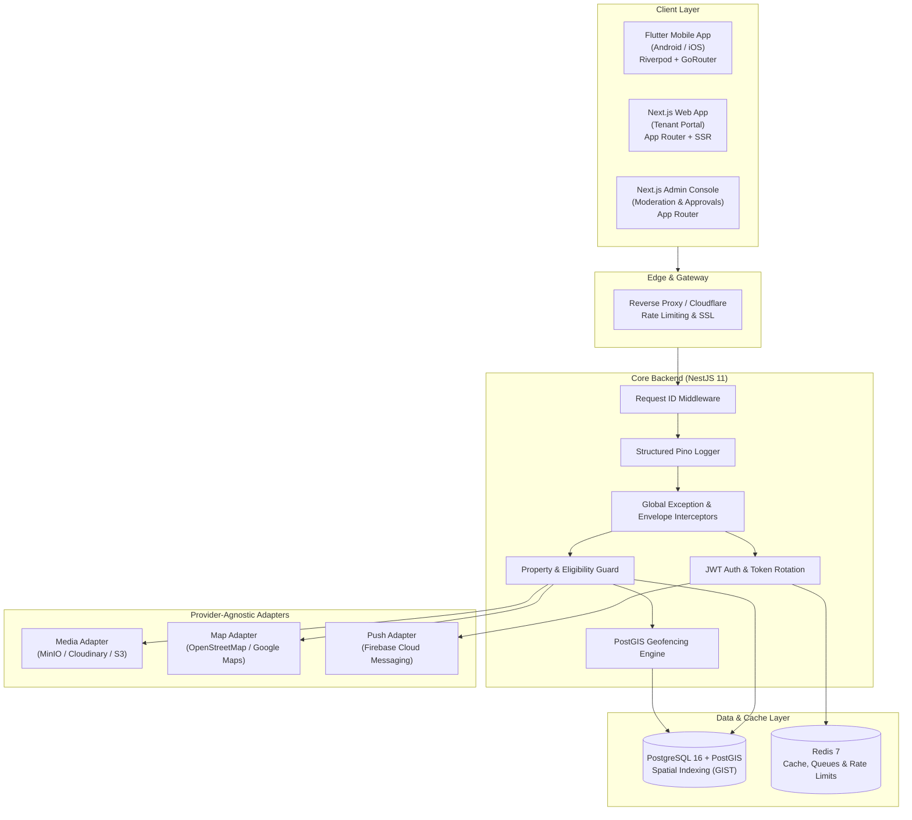

# System Architecture & Technical Specifications

## 1. Executive Overview

The **Rental Marketplace Peshawar** is an enterprise-grade, localized rental property platform engineered exclusively for **Peshawar, Khyber Pakhtunkhwa, Pakistan**. It solves chronic fragmentation, fraudulent postings, and safety issues in Peshawar’s rental market by enforcing two inviolable architectural guarantees:

1. **Strict Eligibility Segregation**: Zero cross-visibility between `STUDENTS_ONLY` and `FAMILIES_ONLY` listings across discovery, search, recommendations, and messaging.
2. **Absolute Spatial Geofencing**: Every property is strictly bound to verified Peshawar municipal coordinates and an active, recognized Peshawar locality.

---

## 2. Monorepo Architecture

The system is organized as a unified, high-cohesion `pnpm` workspace:

```
rental-peshawar/
├── apps/
│   ├── api/          # NestJS 11 REST API, WebSockets, Prisma, PostGIS, Pino
│   ├── web/          # Next.js 15+ App Router tenant discovery portal
│   ├── admin/        # Next.js 15+ App Router governance & verification console
│   └── mobile/       # Flutter 3.27+ with Riverpod, GoRouter, Material 3
├── packages/
│   ├── shared-types/ # Domain enums, DTOs, API envelopes, error codes
│   ├── config/       # Peshawar boundary polygon, localities, validated env schema
│   └── ui/           # Design tokens (Emerald, Terracotta, Slate), typography, spacing
├── docs/             # Technical specifications, API contracts, security standards
├── infra/            # Docker Compose, Dockerfiles, PostGIS init scripts
└── .github/          # GitHub Actions CI/CD workflows
```

---

## 3. High-Level Architecture Diagram



---

## 4. Key Architectural Patterns

### 4.1 Strict Eligibility Firewall

Listing eligibility (`STUDENTS_ONLY` or `FAMILIES_ONLY`) is not merely a client-side filter; it is an invariant:

- Stored as a database `NOT NULL` enum.
- Enforced in search queries at the repository level with indexed composite columns `(eligibility, status, isAvailable)`.
- Enforced on the tenant profile: student tokens cannot retrieve family listings, and family tokens cannot retrieve student listings.

### 4.2 PostGIS Spatial Geofencing

Peshawar metropolitan boundary coordinates are stored as a polygon geometry.

- New property submissions pass through `ST_Contains(boundary, ST_SetSRID(ST_Point(lng, lat), 4326))`.
- Coordinates outside this polygon are rejected with `422 Unprocessable Entity` (`OUTSIDE_SERVICE_BOUNDARY`).

### 4.3 Provider-Agnostic Adapters

All external service dependencies (Media Storage, Maps, Push Notifications) are written behind clean TypeScript interfaces. Swapping local MinIO for AWS S3 or Cloudinary requires zero changes to core business logic.

---

## 5. Technology Matrix

| Layer                 | Component            | Version / Specification           |
| --------------------- | -------------------- | --------------------------------- |
| Monorepo Manager      | pnpm                 | 12.18+ (Node 22+)                 |
| Backend API           | NestJS               | 11.x (Express, TypeScript Strict) |
| Database              | PostgreSQL + PostGIS | PostgreSQL 16, PostGIS 3.4        |
| Database ORM          | Prisma               | 6.x with PostgreSQL Extensions    |
| Cache & Rate Limiting | Redis                | 7.x Alpine                        |
| Tenant Web App        | Next.js              | 15.x App Router                   |
| Admin Console         | Next.js              | 15.x App Router                   |
| Mobile Application    | Flutter              | 3.27+ with Dart 3.6+              |
| Mobile State Mgmt     | flutter_riverpod     | 2.5+                              |
| API Docs              | OpenAPI / Swagger    | 3.0 via @nestjs/swagger           |
| Logging               | Pino                 | Structured JSON + Trace IDs       |
