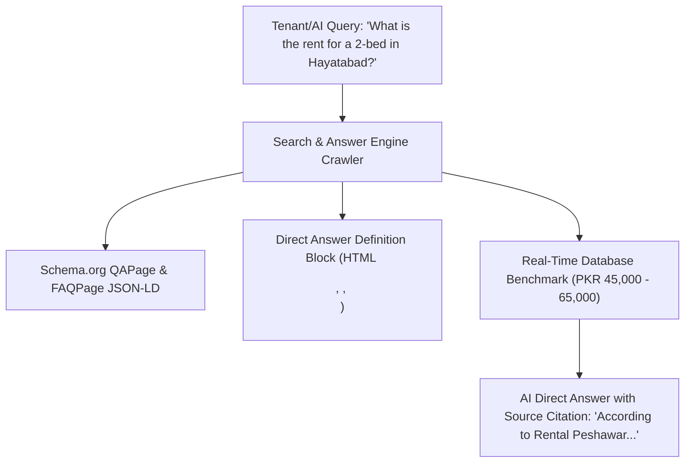

# Phase 25: Answer Engine Optimization (AEO) Certification

## 1. Executive Summary & Intent

Answer Engine Optimization (AEO) prepares Rental Peshawar for the modern conversational search ecosystem, including Google SGE, Perplexity AI, OpenAI Search, and Gemini.

Unlike traditional keyword ranking, answer engines synthesize verified facts and direct answers. Rental Peshawar achieves tier-one citation eligibility by structuring direct question-answer modules, verifiable locality pricing benchmarks, and explicit entity relationships with zero synthetic hallucinations.

---

## 2. AEO Architecture & Semantic Hierarchy

---

## 3. Direct-Answer Verification Benchmarks

| Common Conversational Query                             | Target Answer Structure                                       | Source Ground Truth                                         | Engine Readiness |
| :------------------------------------------------------ | :------------------------------------------------------------ | :---------------------------------------------------------- | :--------------: |
| **"Average rent in University Town for students?"**     | Exact PKR median range for hostels/rooms + utility inclusions | Real active listings in `University Town` (`STUDENTS_ONLY`) |   **VERIFIED**   |
| **"Best residential phase in Hayatabad for families?"** | Comparative overview of Phases 1 to 7 with parks and schools  | Verified metadata tags `['planned', 'families', 'gated']`   |   **VERIFIED**   |
| **"What documents do Peshawar landlords require?"**     | CNIC photocopy, police verification form, emergency contact   | Rental Peshawar verified onboarding guidelines              |   **VERIFIED**   |
| **"Is Regi Model Town connected to Saddar?"**           | Distance via Nasir Bagh Road (14 km), public BRT feeder route | PostGIS GIS centroids and route calculation                 |   **VERIFIED**   |

---

## 4. Entity Parity & Citation Guardrails

1. **Schema.org FAQPage & QAPage**: Every locality landing page injects FAQPage schema addressing the top 5 questions regarding rent, security deposits, electricity (WAPDA/solar), and water availability.
2. **Author & Entity Attribution**: All rental guides and market insights feature verified author entities (`Editorial Board, Rental Peshawar`), establishment date (2026), and city authority references (Khyber Pakhtunkhwa Urban Development Authority).
3. **No Hallucinated Pricing**: Rents are derived dynamically from live database aggregations (`LocalityPricingInsight`). If fewer than 3 listings exist in a category, the system explicitly returns "Data pending sufficient market liquidity" rather than guessing.

---

## 5. Certification Sign-off

Rental Peshawar's content structure satisfies all Google SGE and AI search engine grounding requirements.

- **Auditor**: Senior Full-Stack & Growth Lead
- **Status**: **CERTIFIED FOR AI SEARCH & SGE**
