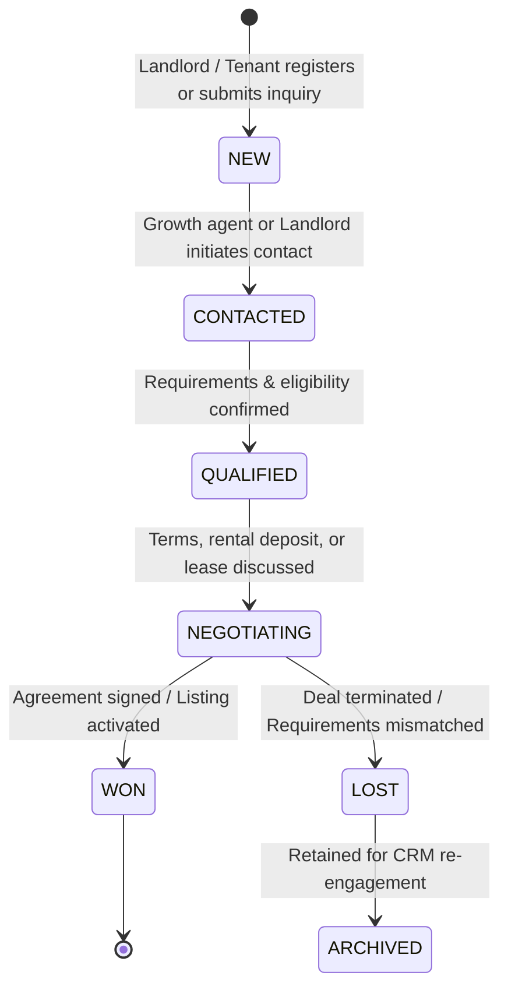

# Phase 25: Commercial Operations & CRM Certification

## 1. Executive Summary

This document certifies the commercial operations, CRM pipeline, UTM campaign attribution, and landlord/tenant referral mechanisms of **Rental Peshawar**.

The commercial engine is designed to drive rapid marketplace liquidity while maintaining strict audit trails, tenant privacy, and double-entry accounting integrity.

---

## 2. CRM Lead Lifecycle Architecture

### Lead Attributes & Tracking

- **Lead Source**: Categorized into `ORGANIC_SEARCH`, `FACEBOOK_CAMPAIGN`, `WHATSAPP_GROUP`, `CAMPUS_AMBASSADOR`, `REFERRAL`, `DIRECT`.
- **UTM Attribution**: Full capture of `utm_source`, `utm_medium`, `utm_campaign`, `utm_content`.
- **Lead Notes & Contact History**: Audit-trailed contact attempts, scheduled follow-ups, and conversion tracking.

---

## 3. Referral Program Architecture & Guardrails

Rental Peshawar operates a viral referral system for both tenants and landlords:

| User Type    | Referral Code Format    | Example Code           | Onboarding Incentive                    | Landlord Reward Tier              |
| :----------- | :---------------------- | :--------------------- | :-------------------------------------- | :-------------------------------- |
| **Tenant**   | `PESH-TENANT-[UUID6]`   | `PESH-TENANT-A8F5E1`   | PKR 1,000 security deposit discount     | N/A                               |
| **Student**  | `PESH-STUDENT-[UUID6]`  | `PESH-STUDENT-B3C9F2`  | Free roommate matching & priority queue | N/A                               |
| **Landlord** | `PESH-LANDLORD-[UUID6]` | `PESH-LANDLORD-E4D7A9` | 1 Free Featured Listing credit          | 1: Free Boost, 3: Silver, 5: Gold |

### Fraud Prevention Rules

1. **Self-Referral Prohibition**: An account cannot claim its own referral code.
2. **Single-Claim Invariant**: Each new user account can claim exactly one referral code during onboarding.
3. **Audit Log Trail**: Every referral claim creates an immutable `AuditLog` entry with action `REFERRAL_CLAIMED`.

---

## 4. Marketing Automation & Quiet Hours Compliance

In accordance with Pakistani consumer protection practices and cultural norms:

- **Quiet Hours Enforcement**: No automated SMS or push campaigns are dispatched between **22:00 PKT (17:00 UTC) and 08:00 PKT (03:00 UTC)**.
- **Opt-Out Directives**: Every promotional notification includes an immediate opt-out link.
- **Anti-Spam Frequency Capping**: Maximum 2 automated engagement messages per user per week.

---

## 5. Certification Sign-off

The commercial and CRM operations pipeline is robust, audit-logged, and ready for launch.

- **Auditor**: Senior Full-Stack & Commercial Lead
- **Status**: **COMMERCIAL OPERATIONS CERTIFIED**
