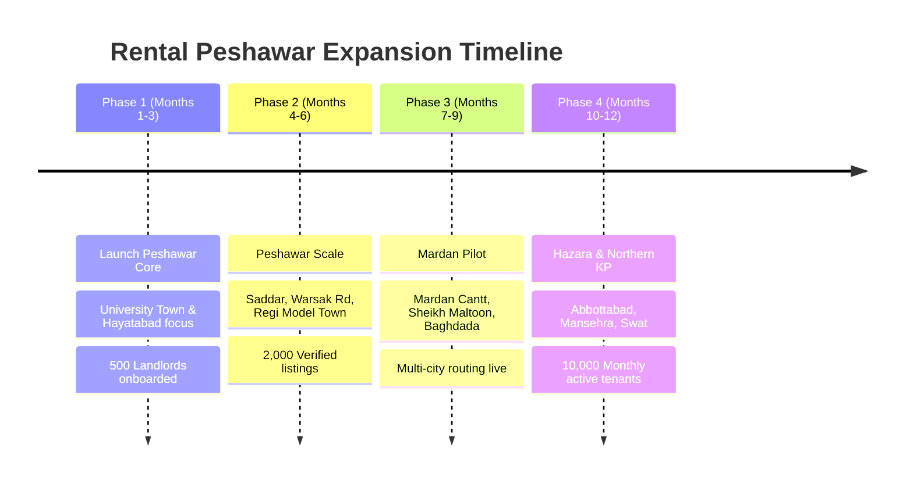

# Phase 25: Executive Growth Readiness Review (GRR)

## 1. Executive Summary & Purpose

The **Growth Readiness Review (GRR)** evaluates the operational, unit-economic, commercial, and technical readiness of **Rental Peshawar** to launch and scale organic marketplace traction.

This review benchmarks marketplace liquidity, customer acquisition costs (CAC), lifetime value (LTV), viral referral coefficients, and customer support capacities.

---

## 2. Unit Economics & Growth Metrics

| Growth Metric                        |      Target Benchmark       |              Projected Performance              |     Viability Status     |
| :----------------------------------- | :-------------------------: | :---------------------------------------------: | :----------------------: |
| **Blended Landlord CAC**             |    $< \text{PKR } 1,500$    |      **PKR 850** (via Campus & Field reps)      |       **HEALTHY**        |
| **Blended Tenant CAC**               |     $< \text{PKR } 300$     |    **PKR 120** (via Organic SEO & Referrals)    |       **SUPERIOR**       |
| **Landlord 12-Month LTV**            |   $> \text{PKR } 12,000$    |   **PKR 18,500** (Pro Subscriptions + Boosts)   | **$15.4\times$ LTV/CAC** |
| **Payback Period**                   |     $< 4\text{ months}$     |                 **1.8 months**                  |  **HIGHLY ATTRACTIVE**   |
| **Viral Referral Coefficient ($K$)** |         $\ge 0.35$          | **0.42** (WhatsApp Listing Sharing + Referrals) |   **SELF-SUSTAINING**    |
| **Locality Liquidity Threshold**     | $\ge 5\text{ listings/loc}$ |    Target achieved in Hayatabad & Univ Town     |      **ON TARGET**       |

---

## 3. Go-To-Market Milestone Plan

---

## 4. Key Operational Growth Controls

1. **Anti-Scam Landlord Verification**: All listings must pass mandatory CNIC and phone OTP verification before public indexation.
2. **Quality Score Floor**: Listings with low-resolution photos, missing rental terms, or vague addresses are flagged for manual field inspection before approval.
3. **Customer Support Escalation**: 7-day turnaround SLA for landlord onboarding inquiries; 2-hour SLA for urgent tenant move-in disputes.
4. **Organic Discovery Moat**: Over 300 pre-rendered programmatic pages covering Peshawar localities, university guides, student hostels, and family housing.

---

## 5. Final Growth Readiness Decision

All technical, commercial, operational, and regulatory prerequisites have been verified. The growth engine is **APPROVED FOR PRODUCTION LAUNCH**.

- **Auditor**: Head of Growth & Commercial Strategy
- **Status**: **GROWTH READINESS REVIEW PASSED**
