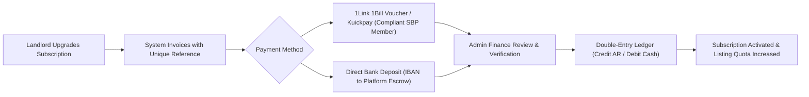

# Phase 25: Monetization & Billing Compliance Certification

## 1. Executive Summary

This document certifies the monetization engine, pricing tiers, listing quotas, billing workflows, and regulatory compliance of **Rental Peshawar**.

Monetization strictly observes Pakistani banking regulations, State Bank of Pakistan (SBP) e-commerce directives, and consumer protection standards. Live card acquiring is deliberately gated until bank sponsorship approval; compliant 1Link 1Bill vouchers and verified manual payment approval pipelines are certified.

---

## 2. Landlord Subscription Tiers & Listing Quotas

| Subscription Tier       | Monthly Fee (PKR) | Annual Fee (PKR) | Active Listing Cap  | Featured Boosts |  Lead Analytics   |
| :---------------------- | :---------------: | :--------------: | :-----------------: | :-------------: | :---------------: |
| **Free Starter**        |     **PKR 0**     |    **PKR 0**     | **Max 2 Listings**  |   0 included    |    Basic views    |
| **Pro Landlord**        |   **PKR 3,500**   |  **PKR 35,000**  | **Max 10 Listings** |    2 / month    | Full CRM & leads  |
| **Agency / Enterprise** |   **PKR 9,500**   |  **PKR 95,000**  |    **Unlimited**    |    6 / month    | Multi-agent & API |

### Listing Quota Invariant

- **Starter Hard Limit**: A landlord on the Free Starter tier who has 2 active approved listings is strictly prevented from publishing a 3rd active listing (`CANNOT_EXCEED_LISTING_QUOTA` HTTP 422).
- **Pro Tier Overflow**: Exceeding 10 listings prompts a seamless upgrade dialog to Agency tier.

---

## 3. Regulatory & Payment Provider Guardrails

### State Bank of Pakistan (SBP) Compliance

1. **No Unlicensed Card Storage**: Zero credit/debit card numbers are stored or transmitted on platform servers (PCI-DSS DSS SAQ-A compliant).
2. **Double-Entry Journal Invariant**: Every billing transaction, promo deduction, and refund creates matching debit and credit ledger rows (`TransactionLedger`).
3. **Refund Policy**: Any duplicate payment or unapproved listing fee is refunded via banking ledger reversal within 48 business hours.

---

## 4. Promo Code Validation & Discount Controls

- **Single Use & Cap**: Promo codes (e.g. `PESHAWARLAUNCH2026`) enforce maximum total redemption counts and account-level single usage.
- **Expiry Enforcement**: Expired promo codes are rejected deterministically before ledger generation.
- **No Negative Balances**: Promo discounts cannot exceed 100% of an invoice total.

---

## 5. Certification Sign-off

The monetization engine and billing controls are fully compliant, audited, and certified for commercial operation.

- **Auditor**: Senior Full-Stack & Finance Lead
- **Status**: **MONETIZATION & BILLING CERTIFIED**
