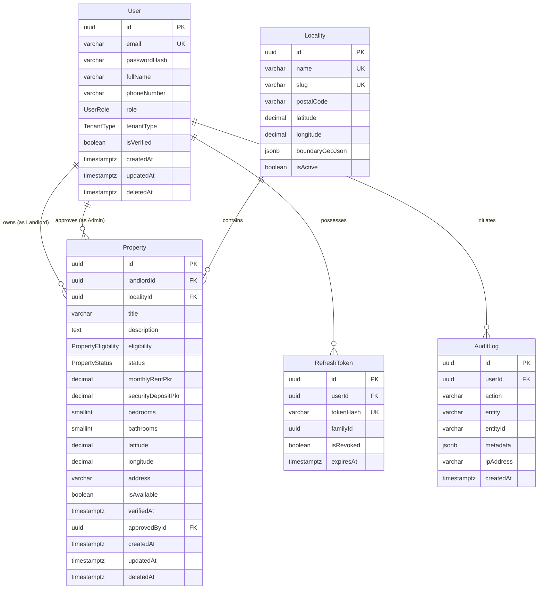

# Database Design & PostGIS Spatial Architecture

## 1. Overview & Extensions

The database engine is **PostgreSQL 16** with the **PostGIS 3.4** extension enabled for high-performance spatial operations.
The schema enforces strict referential integrity, check constraints, composite performance indexes, and immutability for audit trails.

```sql
CREATE EXTENSION IF NOT EXISTS postgis;
CREATE EXTENSION IF NOT EXISTS "uuid-ossp";
```

---

## 2. Entity-Relationship Model



---

## 3. Detailed Table Specifications

### 3.1 `users`

- `id`: UUID primary key via `uuid_generate_v4()`.
- `email`: Normalized lowercase, unique index.
- `role`: Enum (`TENANT`, `LANDLORD`, `ADMIN`, `SUPER_ADMIN`).
- `tenantType`: Enum (`STUDENT`, `FAMILY`), nullable for landlords and admins, required for tenants.
- `deletedAt`: Timestamp for soft-delete compliance.

### 3.2 `localities`

- `id`: UUID primary key.
- `name`: Unique name (e.g. `University Town`, `Hayatabad`).
- `slug`: URL-safe unique identifier.
- `latitude` / `longitude`: Exact centroid coordinates (Precision 10, scale 7).
- `isActive`: Boolean flag controlling availability for property assignment.

### 3.3 `properties`

- `id`: UUID primary key.
- `eligibility`: Strict Enum (`STUDENTS_ONLY`, `FAMILIES_ONLY`). Indexed with status.
- `status`: Enum (`DRAFT`, `PENDING_REVIEW`, `APPROVED`, `REJECTED`, `SUSPENDED`, `RENTED`, `UNAVAILABLE`, `DELETED`).
- `monthlyRentPkr` / `securityDepositPkr`: Stored as `DECIMAL(12, 2)` to eliminate floating-point currency drift.
- `latitude` / `longitude`: Stored as `DECIMAL(10, 7)`.
- `deletedAt`: Nullable timestamp for soft deletion.

### 3.4 `refresh_tokens`

- Supports cryptographic rotating refresh tokens with token family replay detection.
- `familyId`: UUID grouping rotation chain for instant revocation on breach detection.

### 3.5 `audit_logs`

- Immutably captures all state changes, administrative approvals, eligibility overrides, and security events.

---

## 4. Indexing Strategy

| Table        | Index Columns                        | Index Type       | Purpose                                                              |
| ------------ | ------------------------------------ | ---------------- | -------------------------------------------------------------------- |
| `users`      | `email`                              | B-TREE Unique    | Instant user lookup during authentication                            |
| `users`      | `(role, tenantType)`                 | B-TREE           | Role and tenant filtering                                            |
| `properties` | `(eligibility, status, isAvailable)` | Composite B-TREE | Primary search query optimization (Zero scan of irrelevant listings) |
| `properties` | `(localityId, status)`               | Composite B-TREE | Locality-specific filtering                                          |
| `properties` | `(status, deletedAt)`                | Composite B-TREE | Excludes archived and unapproved listings                            |
| `localities` | `slug`                               | B-TREE Unique    | Locality page routing                                                |
| `audit_logs` | `(entity, entityId, createdAt)`      | Composite B-TREE | Audit trail retrieval                                                |
