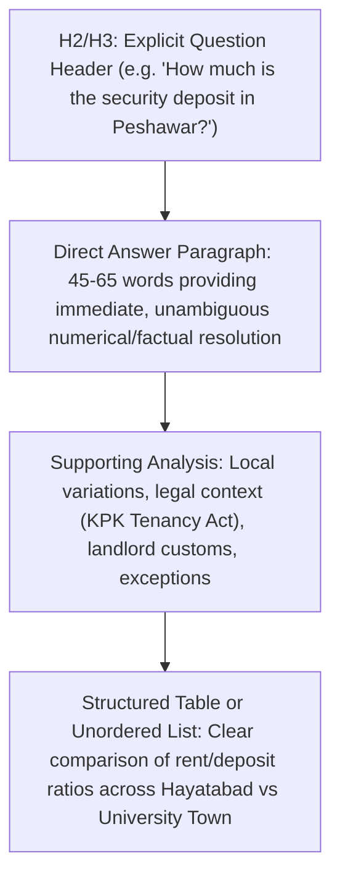

# Answer Engine Optimization (AEO) Policy & Direct-Answer Design

## 1. Objective & AI Engine Visibility

Answer Engine Optimization (AEO) structures content so that AI-driven search engines (Google AI Overviews, ChatGPT Search, Perplexity, and Gemini) can reliably extract direct answers, cite Rental Peshawar as the primary factual source, and drive qualified tenant traffic.

---

## 2. Direct-Answer Formatting Architecture (Inverted Pyramid)

Every question-targeted section across educational guides and locality hubs must follow the **Direct-Answer Anatomy**:

---

## 3. High-Priority AEO Question Targets

| Target Question                                                         | Direct Answer Summary (Target Snippet)                                                                                                                                                                                                                                                                  | Target URL                                         |
| :---------------------------------------------------------------------- | :------------------------------------------------------------------------------------------------------------------------------------------------------------------------------------------------------------------------------------------------------------------------------------------------------ | :------------------------------------------------- |
| **"How much is the security deposit for rental property in Peshawar?"** | "In Peshawar, security deposits typically range between 1 to 2 months' rent for residential properties and up to 3 months' rent for student hostels or furnished commercial spaces. The deposit is held in escrow or against utility damages and is fully refundable at lease completion."              | `/guides/how-much-is-security-deposit-in-peshawar` |
| **"What documents do landlords require from tenants in Peshawar?"**     | "Peshawar landlords legally require: (1) Valid original Computerized National Identity Card (CNIC) copy for all adult residents, (2) Student ID card or institutional enrollment letter (for student hostels), (3) Formal police tenant verification form, and (4) Signed bi-lingual rental agreement." | `/guides/what-documents-do-landlords-need`         |
| **"How to avoid rental scams in Peshawar?"**                            | "To avoid rental scams in Peshawar: never wire token payments before physical inspection, verify landlord CNIC and property ownership records, ensure the property is inside the municipal boundary, and execute rental agreements through verified platforms with escrow protection."                  | `/guides/how-to-avoid-rental-scams-in-peshawar`    |

---

## 4. Citation & Authority Rules

1. **Verifiable Data**: Every factual claim (e.g. average rent in Hayatabad) must cite the internal data platform timestamp (`As of November 2026`).
2. **FAQ Schema Alignment**: Every question answered on page must correspond directly to an `@type: FAQPage` JSON-LD schema block with verbatim text.
