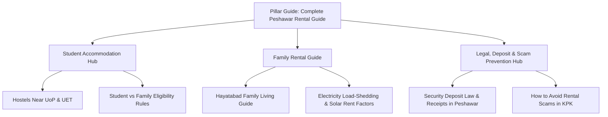

# Peshawar Rental Content Strategy & Editorial Standards

## 1. Content Philosophy (People-First & Locally Verified)

Rental Peshawar rejects automated spun articles, doorway pages, and keyword-stuffed text. Every published guide, locality profile, and property narrative must adhere to Google's Helpful Content Standards (E-E-A-T: Experience, Expertise, Authoritativeness, and Trustworthiness).

---

## 2. Topic Clusters & Content Hubs

---

## 3. Editorial & Local Accuracy Guidelines

1. **Local Context Mandate**: Content must reflect genuine Peshawar realities (e.g., Peshawar BRT Zu Peshawar routes, feeder buses, load-shedding generator backup norms, local water table considerations in Hayatabad vs Warsak Road).
2. **Transparent Author Information**:
   - Every guide must cite a verified local author or editorial reviewer with verified Peshawar real estate knowledge.
   - Visible "Last Updated" timestamp matching Schema.org `dateModified`.
3. **No Thin Locality Pages**:
   - Locality pages (`/rentals/peshawar/[localitySlug]`) must only be indexable if there is either active verified inventory or substantial locality guidance.
   - Empty or low-inventory localities are merged or set to `noindex` until genuine supply is onboarded.
4. **Verified Price Statistics**: Average rent figures displayed on locality pages are dynamically computed from active listings in PostgreSQL (`LocalityPricingInsight`), never fabricated.
