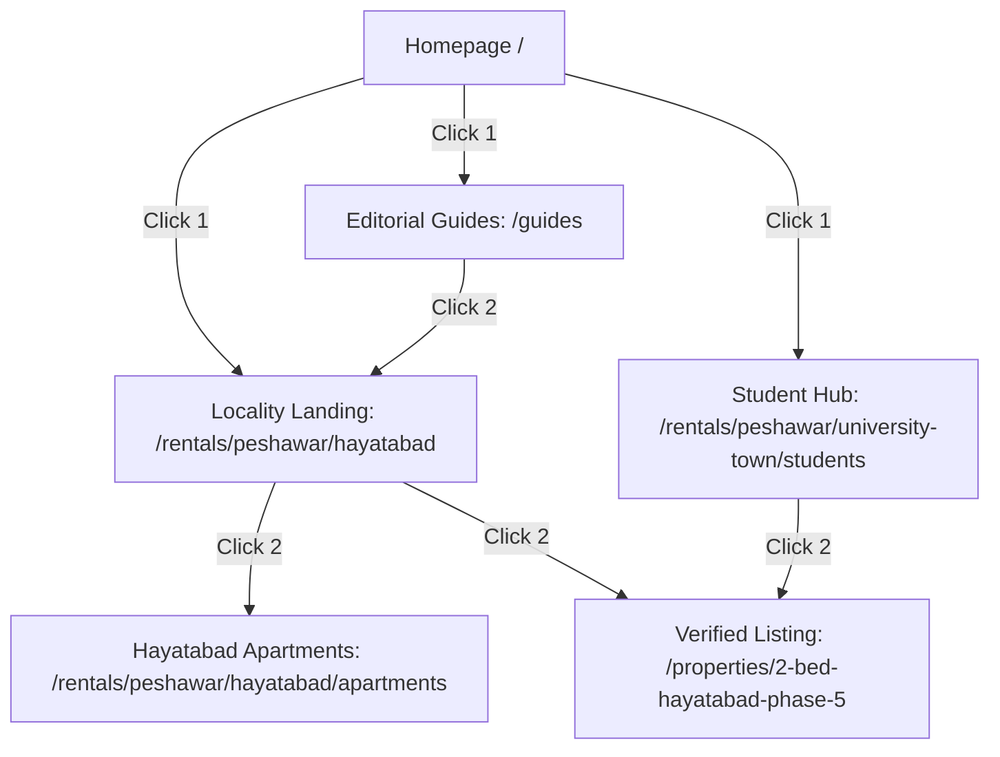

# Internal Linking Architecture & Crawl Depth Policy

## 1. Crawl Depth & Information Architecture

Search crawlers and human renters must be able to reach any verified public property listing in Peshawar within a **maximum of 3 clicks** from the homepage.

---

## 2. Contextual Linking Matrix

| Page Type                | Outbound Contextual Links Required                                                                   | Anchor Text Best Practice                                           |
| :----------------------- | :--------------------------------------------------------------------------------------------------- | :------------------------------------------------------------------ |
| **Homepage**             | Top 6 Peshawar Localities, Student Accommodations, Family Portions, Editorial Guides.                | "Apartments in University Town", "Houses in Hayatabad"              |
| **Property Detail Page** | Parent Locality Page, Property Type Category, Similar Properties in Locality, Relevant Safety Guide. | "More 2-Bed Apartments in Hayatabad", "Hayatabad Rental Guide"      |
| **Locality Page**        | Active listings, Student/Family segment toggles, Nearby Localities, Locality FAQ.                    | "Student Hostels in University Town", "Rental rates in Warsak Road" |
| **Editorial Guide Page** | Relevant Locality Hubs, Search catalog, Scam prevention checklist.                                   | "Browse University Town Student Rooms", "Check verified listings"   |

---

## 3. Anchor Text & Link Equity Rules

1. **Descriptive Anchor Text**: Generic phrases like "click here" or "learn more" are strictly prohibited in SEO templates. Anchor text must describe the target entity (e.g., `Browse verified houses for rent in Hayatabad Phase 4`).
2. **Breadcrumb Integration**: Every indexable page features full schema-backed Breadcrumbs:
   `Home > Peshawar Rentals > Hayatabad > 2-Bed Apartment Phase 5`.
3. **Link Equity Preservation**: No links pointing to `noindex` or authenticated routes (e.g. `/dashboard`, `/profile`) may be placed without `rel="nofollow"`.
