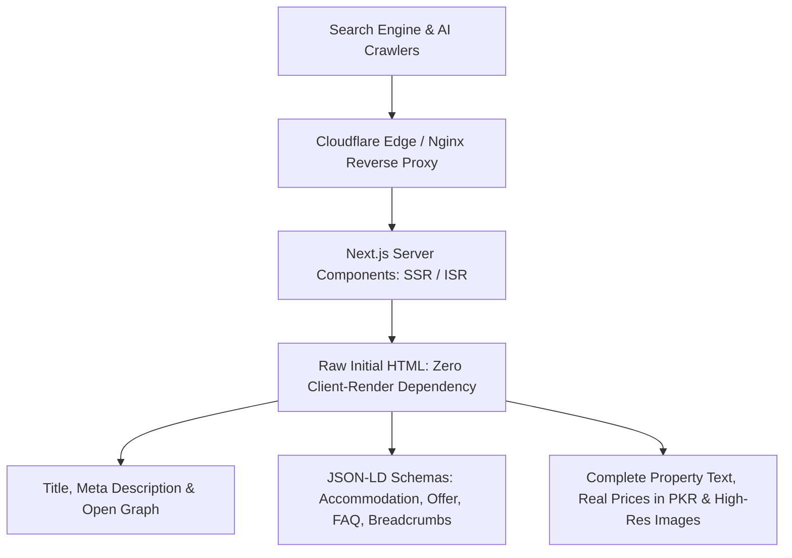

# Peshawar Organic Growth & Technical SEO Strategy

## 1. Executive Summary & Market Positioning

The Rental Peshawar SEO strategy is engineered to capture high-intent tenant and landlord search demand across Peshawar without relying on keyword stuffing, doorway pages, or auto-spun thin content.

Peshawar's rental market features distinct demand pools:

1. **Student Segment**: Concentrated around University of Peshawar, UET Peshawar, Khyber Medical College (KMC), and Islamia College, actively searching for hostels, single rooms, shared apartments, and mess-inclusive housing in University Town and bordering localities.
2. **Family Segment**: Concentrated in Hayatabad (Phases 1–7), Warsak Road, Regi Model Town, and Defence Colony, searching for multi-bedroom houses, independent portions, and family-approved apartments with uninterrupted utilities and security.
3. **Landlord Segment**: Seeking verified tenants, digital agreements, and low-vacancy placement.

---

## 2. Technical Architecture & Crawlability Baseline



### Core Architecture Tenets

- **Server-Side Rendering (SSR) & Static Generation (ISR)**: All public listing pages, locality landing pages, and educational guides render critical content directly into initial server HTML.
- **Canonical URL Enforcement**: Every public page specifies an absolute `rel="canonical"` URL to prevent query parameter dilution.
- **Strict HTTP Status Semantics**:
  - Available & approved listings: `200 OK`
  - Inactive / filtered search queries: `noindex, follow`
  - Missing, suspended, or unapproved listings: `404 Not Found`
  - Permanently expunged records: `410 Gone`
  - Changed URL structures: `301 Moved Permanently`

---

## 3. Programmatic URL Hierarchy

```
/properties                                -> Global Peshawar catalog (SSR)
/properties/[slug]                         -> Verified Property Detail Page (SSR + JSON-LD)
/rentals/peshawar/[localitySlug]           -> Locality Hub (Hayatabad, University Town, etc.)
/rentals/peshawar/[localitySlug]/students  -> Student-Filtered Locality Inventory & Hostels
/rentals/peshawar/[localitySlug]/families  -> Family-Filtered Locality Houses & Portions
/rentals/peshawar/[localitySlug]/[type]    -> Locality + Property Type (e.g. /hayatabad/apartments)
/areas/[localitySlug]                      -> Geographic Locality & Living Guide
/guides/[slug]                             -> AEO Direct-Answer Editorial Guides
```

---

## 4. Crawl Budget & Index Optimization

1. **Noindex Directives**: All dashboard pages, authenticated routes (`/messages`, `/inquiries`, `/profile`), administrative portals (`/admin`), and filtered faceted search URLs are tagged with `<meta name="robots" content="noindex, follow">`.
2. **Dynamic XML Sitemaps**: Automated sitemaps refresh on listing state transitions, indexing only `APPROVED` and `AVAILABLE` inventory.
3. **Core Web Vitals Target**:
   - Largest Contentful Paint (LCP): $\le 2.0\text{ seconds}$
   - Interaction to Next Paint (INP): $\le 150\text{ ms}$
   - Cumulative Layout Shift (CLS): $\le 0.05$
