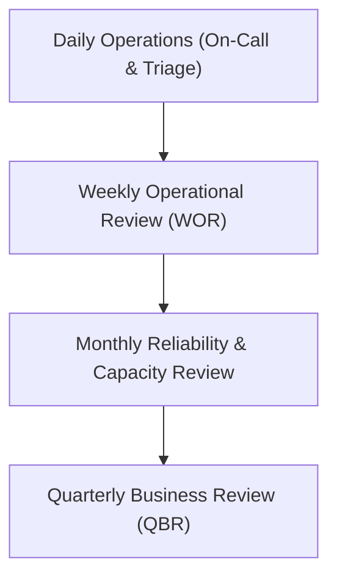

# Platform Sustained Operating Cadence

## 1. Operating Rhythm Overview

To guarantee long-term stability, continuous improvement, and operational excellence, **Rental Peshawar** establishes a disciplined operating cadence across daily, weekly, monthly, and quarterly intervals.

---

## 2. Daily Cadence (Operational Baseline)

**Audience**: On-Call Primary SRE, Support Lead, Moderation Lead  
**Time Commitment**: 15–30 minutes daily (09:00 PKT)

- [ ] **Critical Alert Triage**: Review any fired Prometheus/Alertmanager alerts in the preceding 24 hours.
- [ ] **API Error Rate & Availability**: Verify that 5xx error rate is $< 0.1\%$ across all core endpoints.
- [ ] **Queue Backlog Inspection**: Check BullMQ queue depth for email, SMS, and notification dispatches.
- [ ] **Security Anomaly Scan**: Inspect failed login spikes, blocked IDOR attempts, and geo-perimeter violation alerts.
- [ ] **Moderation Queue Audit**: Confirm that landlord listings and CNIC submissions are reviewed within the 4-hour SLA.
- [ ] **Support Ticket Triage**: Ensure tenant move-in disputes and urgent inquiries are assigned and acknowledged.
- [ ] **Offline Payment Reconciliation**: Validate offline 1Link voucher receipts and clear verified subscriptions.
- [ ] **Backup Verification**: Confirm successful completion of the nightly automated PostgreSQL dump and hourly WAL archiving.

---

## 3. Weekly Cadence (Weekly Operational Review - WOR)

**Audience**: Engineering Leads, SRE Lead, QA Lead, Product Owner  
**Time Commitment**: 60 minutes (Every Monday, 11:00 PKT)

- [ ] **SLO & Error Budget Burn Rate**: Review trailing 7-day and 30-day error budget consumption. If consumption $> 20\%$, apply release gate restrictions.
- [ ] **Deployment Health & Rollback Review**: Review deployments executed in the prior sprint; confirm zero unresolved regressions.
- [ ] **Technical Debt Register Burndown**: Review active debt items; ensure at least 20% of engineering bandwidth is allocated to tech debt remediation.
- [ ] **Customer Feedback & Review Analysis**: Triage tenant and landlord ratings, NPS trends, and concierge escalations.
- [ ] **Growth & Funnel Performance**: Review weekly tenant registrations, active search sessions, inquiry conversion, and referral activations.
- [ ] **SEO & Indexing Health**: Audit Google Search Console coverage, sitemap indexing status, and Core Web Vitals.
- [ ] **Fraud & Abuse Triage**: Review suspicious listing reports, duplicate image hashes, and banned accounts.

---

## 4. Monthly Cadence (System Reliability & Strategy)

**Audience**: Department Heads, Technical Director, Finance Lead  
**Time Commitment**: 90 minutes (First Wednesday of each month)

- [ ] **SLO Definition Re-calibration**: Re-evaluate service level objectives against actual user expectations and market growth.
- [ ] **Capacity Planning & Cloud Cost Optimization**: Analyze database disk growth, Redis memory utilization, CDN bandwidth, and monthly cloud spend.
- [ ] **Security Posture & Patch Management**: Audit dependency vulnerability scans (`pnpm audit`), apply OS/Docker base image security patches, and review IAM permissions.
- [ ] **Disaster Recovery Restore Drill**: Execute an automated database restore test into an isolated staging environment to verify backup integrity and RTO.
- [ ] **Blameless Postmortem Action Review**: Track progress of preventive action items resulting from any SEV-1 or SEV-2 incidents.
- [ ] **Monetization & Commercial Review**: Review MRR, ARPU, subscription churn, and commercial pipeline velocity.

---

## 5. Quarterly Cadence (Quarterly Business Review - QBR)

**Audience**: Executive Leadership, Investors, Senior Management  
**Time Commitment**: Half-Day Executive Session (End of each quarter)

- [ ] **Comprehensive Business & Financial Review**: Review revenue, Gross Merchandise Value (GMV), CAC/LTV, and payback periods.
- [ ] **Architecture & Platform Evolution**: Review structural roadmap, microservice boundary refactoring, and multi-region readiness.
- [ ] **Penetration Testing & Third-Party Security Audit**: Commission external security review and review findings.
- [ ] **Multi-City Expansion Readiness**: Assess market liquidity, local partnerships, and municipal readiness for expanding to Mardan, Abbottabad, and Swat.
- [ ] **Vendor & Supply Chain Risk Review**: Audit third-party dependencies (cloud providers, telco SMS gateways, map providers).
