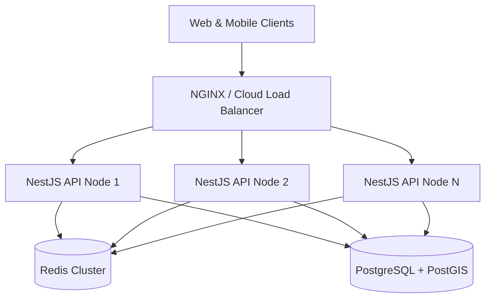

# Scale Readiness & Architecture Strategy — Rental Peshawar

This document outlines the architecture, concurrency limits, and horizontal scaling strategies designed to support high-growth rental marketplace operations in Peshawar.

---

## 1. Stateless API Horizontal Scaling

- **Stateless Architecture:** The NestJS API nodes maintain zero session state in local memory.
- **JWT & Token Rotation:** Authentication tokens are cryptographically signed. Revocation checks and refresh token family tracking are powered by high-speed Redis queries (`O(1)` latency).
- **Docker & Container Replicas:** The API service can scale horizontally to $N$ instances behind NGINX or AWS ALB.

---

## 2. Real-Time Communications & WebSocket Scaling

- **Socket.io Redis Pub/Sub Adapter:** WebSocket gateways in `ConversationModule` scale horizontally across multiple NestJS nodes by publishing and subscribing to Redis channels.
- When Landlord A on Node 1 replies to Student B connected to Node 2, the message is dispatched across Redis Pub/Sub in real time (< 5ms).

---

## 3. Database Scaling & Partitioning Strategy

1. **Connection Pooling:**
   - Prisma connection pool is capped at `connection_limit=50` per node.
   - For scale beyond 10 API nodes, PgBouncer is deployed in transaction pooling mode.
2. **Table Partitioning:**
   - `property_view_events`: Range-partitioned by month (`createdAt`) to handle millions of search and listing impressions without degrading primary search latency.
   - `messages`: Hash-partitioned across conversation IDs or range-partitioned quarterly.
3. **Read Replicas:**
   - Read-heavy queries (search, locality benchmarks, sitemaps, and public property views) are directed to PostgreSQL streaming read replicas.

---

## 4. Background Job Queues

- **Image Processing Queue:** Image resizing, WebP conversion, and checksum deduplication run in isolated background workers via BullMQ / Redis.
- **Notification Delivery Queue:** Firebase Cloud Messaging (FCM) pushes and SMS notifications are buffered in Redis queues with exponential backoff retries.
- **Analytics Aggregator Queue:** Hourly rollups of views, inquiries, and search conversion are computed asynchronously without blocking HTTP threads.

---

## 5. Edge Caching & CDN Strategy

- **Cloudflare / CDN Integration:**
  - Property images and static frontend assets cached at edge with 30-day `Cache-Control: public, max-age=2592000, immutable`.
  - Localized locality landing pages cached for 1 hour (`stale-while-revalidate=86400`).
  - Strict exclusion for `/api/v1/auth`, `/api/v1/conversations`, and admin consoles.
