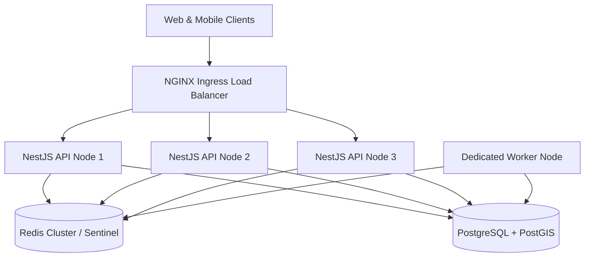

# Scale Readiness & Architecture Strategy — Rental Peshawar

Phase 14: Event-Driven Architecture, Background Jobs, Data Platform & Scale Infrastructure

This document outlines the architecture, concurrency limits, event-driven pipelines, and horizontal scaling strategies designed to support high-growth rental marketplace operations in Peshawar.

---

## 1. Stateless API Horizontal Scaling & Edge Ingress

- **Stateless Architecture:** All NestJS API nodes maintain zero session state in local process memory.
- **Graceful Shutdown Hooks:** All nodes register `app.enableShutdownHooks()` to finish inflight requests and safely disconnect from Redis and PostgreSQL on SIGTERM / rolling deploys.
- **JWT & Token Rotation:** Authentication tokens are cryptographically signed. Revocation checks and refresh token family tracking are powered by high-speed Redis queries (`O(1)` latency).
- **Edge Load Balancing:** Multi-instance API cluster sits behind an Nginx reverse proxy with `least_conn` load balancing, keepalive connections, and connection pooling. Orchestrated via `docker-compose.scale.yml`.



---

## 2. Event-Driven Architecture & Transactional Outbox

To guarantee atomic consistency across distributed operations without dual-write risks, Rental Peshawar implements the **Transactional Outbox Pattern**:

1. **Transactional Enqueue:** Domain events are committed in PostgreSQL `domain_event_outbox` within the exact same ACID transaction as entity updates.
2. **Outbox Batch Processor:** Background workers query staged events in batches with exponential backoff and publish them to BullMQ Redis queues.
3. **Immutable Event Store:** Dispatched events are immutably archived into `event_store` with schema versioning (`v1.0`), SHA-256 idempotency hash, and payload JSON.
4. **Replay Engine:** Administrators can replay historical events from any timestamp or event type to rebuild projections, warm caches, or recover from downstream service downtime.

### Supported Core Domain Events (24 Types):

- `user_registered`, `user_verified`, `landlord_verified`
- `property_created`, `property_submitted`, `property_approved`, `property_rejected`, `property_suspended`, `property_marked_available`, `property_marked_rented`, `property_viewed`, `property_favorited`
- `inquiry_created`, `inquiry_accepted`, `inquiry_declined`
- `booking_requested`, `booking_accepted`, `booking_declined`, `booking_paid`, `booking_cancelled`, `booking_expired`
- `payment_succeeded`, `payment_failed`
- `review_submitted`, `report_submitted`

---

## 3. Background Job Queues & Worker Concurrency

Background workloads are isolated into dedicated queue workers to protect HTTP request latencies.

### Configured Background Jobs (17 Handlers):

1. `send_notification`: FCM push & in-app alerts with retry budget.
2. `send_sms`: OTP and urgent lease notifications with circuit-breaker protection.
3. `send_email`: Transaction receipts, lease agreements, and account notices.
4. `resize_image`: Multi-resolution WebP optimization and EXIF sanitization.
5. `calculate_reputation`: Periodic Bayesian scoring of landlord trustworthiness.
6. `calculate_property_quality`: Property listing completeness and quality scoring.
7. `expire_unpaid_bookings`: Auto-cancel unpaid booking requests past SLA.
8. `clean_expired_tokens`: Invalidate expired refresh tokens and session tokens.
9. `generate_daily_analytics`: Roll up views, clicks, and inquiries into daily aggregates.
10. `reindex_search`: Refresh full-text and spatial search indices.
11. `dispatch_search_alerts`: Match newly approved listings against saved searches.
12. `generate_agreement_pdf`: Render signed rental agreements into archival PDFs.
13. `process_escrow_payout`: Schedule municipal-compliant payout transactions.
14. `calculate_locality_demand`: Compute locality inquiry velocity and rent trends.
15. `prune_audit_logs`: Archive old operational logs past retention window.
16. `backup_database`: Periodic snapshot verification.
17. `cleanup_temp_media`: Purge unattached draft upload assets after 24 hours.

### Reliability Guarantees:

- **Idempotency Keys:** Every job execution validates its SHA-256 idempotency key in Redis before processing, preventing duplicate actions.
- **Exponential Backoff:** Up to 3 retry attempts with exponential jitter (`attempts * 2000ms`).
- **Dead-Letter Queue (DLQ):** Failed jobs exhausting retry limits are safely escalated to the `DeadLetterJob` table. Admins can inspect stack traces, edit payloads, and manually retry via the Admin Jobs Console.

---

## 4. Multi-Tier Caching & Invalidation Policy

Rental Peshawar uses a two-tier caching hierarchy:

1. **Tier 1 (Redis):** Distributed cache with LRU memory eviction.
2. **Tier 2 (In-Memory Fallback):** Zero-downtime degradation buffer if Redis becomes unreachable.

| Cache Key Pattern     | Configured TTL | Data Stored                          | Invalidation Trigger           |
| :-------------------- | :------------- | :----------------------------------- | :----------------------------- |
| `localities:*`        | 24 Hours       | Locality polygon coordinates & stats | Locality CRUD updates          |
| `amenities:all`       | 24 Hours       | Master amenity dictionary            | Admin amenity updates          |
| `featured:properties` | 5 Minutes      | Spotlighted verified listings        | Property approval/rented state |
| `property:details:*`  | 60 Seconds     | Full property detail JSON payload    | Property update/media edit     |
| `search:results:*`    | 30 Seconds     | Search query result sets & counts    | Any listing change in locality |
| `locality:boundary:*` | 24 Hours       | PostGIS boundary GeoJSON             | Boundary geometry updates      |
| `config:public`       | 10 Minutes     | Dynamic feature flags & configs      | Admin setting modifications    |

---

## 5. PostgreSQL Declarative Table Partitioning & Data Platform

High-volume event tables use PostgreSQL declarative **range partitioning by month (`createdAt`)**:

- `property_view_events`
- `property_clicks`
- `search_query_logs`
- `messages`
- `notifications`
- `audit_logs`

### Partition Maintenance:

- Dynamic DDL generator (`DataPlatformService.generateMonthlyPartitionDdl`) produces future monthly partition tables with matching indices without locking parent tables:
  ```sql
  CREATE TABLE IF NOT EXISTS property_view_events_2026_03
  PARTITION OF property_view_events
  FOR VALUES FROM ('2026-03-01 00:00:00+00') TO ('2026-04-01 00:00:00+00');
  ```

### GDPR & Right to Erasure (PII Anonymization):

- `DataPlatformService.anonymizeUserData`:
  - Hashing of email and phone (`anon_<hash>@peshawar.internal`).
  - Redaction of full name to `"Anonymized User"`.
  - Permanent purge of CNIC documents, selfies, and verification biometric records.
  - Retention of immutable financial ledger rows, lease agreements, and audit logs required for municipal compliance.

---

## 6. Circuit Breaker for External Scale & Resilience

External third-party services (JazzCash, EasyPaisa, SMS Gateways) are wrapped in `CircuitBreakerService`:

- **CLOSED:** Normal pass-through operations.
- **OPEN:** After 5 consecutive failures, circuit trips open for 15 seconds, instantly failing fast to protect backend worker threads.
- **HALF_OPEN:** Allows probe requests to test provider health before resuming normal traffic.

---

## 7. Mobile Flutter UI Performance Standards

- **Frame Budget:** 16ms per frame target to maintain steady 60 FPS scrolling on Android and iOS devices.
- **Const Constructors:** Pervasive use of `const` widgets across list tiles, cards, and dialogs to avoid unnecessary element rebuilds.
- **Image Memory Management:** `CachedNetworkImage` with custom `memCacheWidth` and `memCacheHeight` limits to eliminate RAM pressure when rendering high-res property photo galleries.
- **Asynchronous Decoupling:** Heavy image uploads and PDF downloads are offloaded to background isolates with non-blocking UI indicators.
