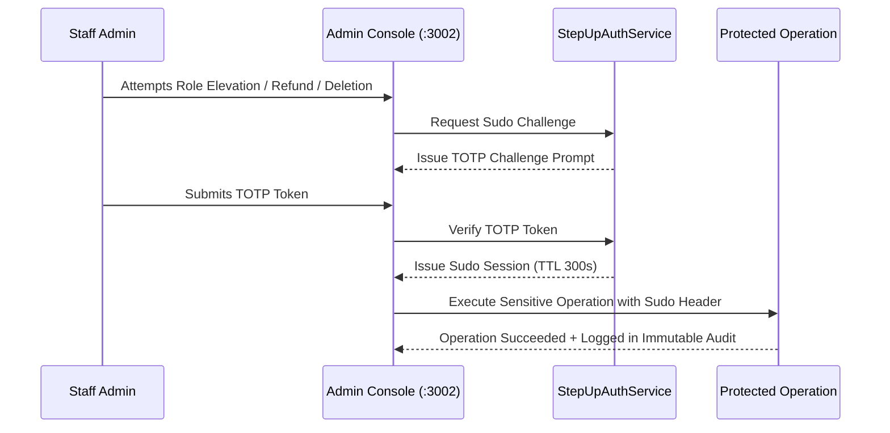

# Administrative Access, Bastion Architecture & Break-Glass Protocol

## 1. Zero Standing Privileges Philosophy

Direct administrative access to production systems is prohibited. All administrative interactions occur via Identity-Aware Proxies (IAP), temporary session grants, and step-up authentication.

1. **Mandatory MFA / TOTP**: Access to the Admin Portal, cloud management console, and repository settings requires hardware or authenticator-based MFA.
2. **Key-Based SSH via Bastion**:
   - Password authentication for SSH is disabled (`PasswordAuthentication no`).
   - SSH access is permitted only through a dedicated hardened Bastion / VPN gateway with ed25519 public keys.
   - SSH sessions are recorded and logged to central audit vaults.

---

## 2. Step-Up Authentication for High-Value Admin Operations

Administrative operations affecting user rights, financial ledgers, or platform security require an elevated **sudo token** issued through TOTP step-up authentication:

High-Value Operations Requiring Step-Up:

- `ROLE_CHANGE`: Promoting users to `ADMIN` or changing role permissions.
- `USER_DELETION`: Permanent account removal under privacy requests.
- `PAYMENT_REFUND`: Releasing escrowed security deposits or reversing payments.
- `AUDIT_LOG_EXPORT`: Exporting compliance logs.
- `LOCALITY_BOUNDARY_CHANGE`: Altering Peshawar municipal geo-boundaries.
- `VERIFICATION_OVERRIDE`: Manually verifying or rejecting landlord CNIC records.

---

## 3. Emergency Break-Glass Runbook

When automated authentication systems fail or catastrophic outages occur, designated Emergency Responders use the **Break-Glass Protocol**:

1. **Dual Authorization**: Retrieval of break-glass credentials requires approval from at least two authorized keyholders.
2. **Immediate Alert Broadcast**: Accessing the break-glass safe immediately dispatches high-priority alerts to the entire engineering leadership (Slack, PagerDuty, SMS).
3. **Automated Audit Lockdown**: Every command executed under break-glass mode is written to an append-only remote log stream.
4. **Credential Invalidation**: Once the incident is resolved, break-glass credentials are automatically rotated and invalidated within 4 hours.
