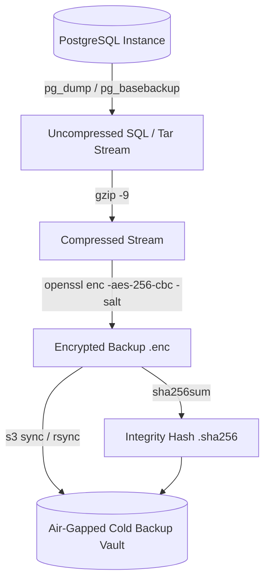

# Backup, Disaster Recovery & Cryptographic Verification

## 1. Resilience Objectives

- **RPO (Recovery Point Objective)**: $\le 15\text{ minutes}$ (continuous WAL archiving).
- **RTO (Recovery Time Objective)**: $\le 60\text{ minutes}$ (full cluster restoration).

---

## 2. Backup Architecture & Encryption Pipeline

All database and object storage backups are encrypted before leaving the primary database host using OpenSSL AES-256-CBC or GPG with asymmetric public keys.



---

## 3. Cryptographic Verification & Restoration Procedure

Per NIST SP 800-34 Rev. 1, backups must be cryptographically verified prior to execution to prevent tampering and corruption:

### A. Automated Backup & Encryption Script (`backup-and-encrypt.sh`)

```bash
#!/usr/bin/env bash
set -euo pipefail

BACKUP_DATE=$(date +%Y%m%d_%H%M%S)
BACKUP_DIR="/var/backups/rental_peshawar"
RAW_FILE="${BACKUP_DIR}/db_${BACKUP_DATE}.sql.gz"
ENC_FILE="${BACKUP_DIR}/db_${BACKUP_DATE}.sql.gz.enc"
SHA_FILE="${ENC_FILE}.sha256"

# 1. Create compressed dump using least-privilege backup_user
pg_dump -U backup_user -h localhost rental_peshawar_prod | gzip -9 > "$RAW_FILE"

# 2. Encrypt using AES-256-CBC with encryption key from key vault
openssl enc -aes-256-cbc -salt -pbkdf2 -iter 100000 \
  -in "$RAW_FILE" -out "$ENC_FILE" -pass "pass:${BACKUP_ENCRYPTION_KEY}"

# 3. Generate SHA-256 integrity checksum
sha256sum "$ENC_FILE" > "$SHA_FILE"

# 4. Remove unencrypted raw dump
rm -f "$RAW_FILE"

echo "Backup complete: ${ENC_FILE} (SHA256 verified)"
```

### B. Cryptographic Verification & Restoration (`verify-and-restore.sh`)

```bash
#!/usr/bin/env bash
set -euo pipefail

ENC_FILE="$1"
SHA_FILE="${ENC_FILE}.sha256"

# 1. Integrity check
echo "Verifying SHA-256 checksum..."
sha256sum -c "$SHA_FILE"

# 2. Decrypt to temporary stream
echo "Decrypting backup stream..."
openssl enc -d -aes-256-cbc -pbkdf2 -iter 100000 \
  -in "$ENC_FILE" -pass "pass:${BACKUP_ENCRYPTION_KEY}" | gunzip | psql -U migration_user -d rental_peshawar_restored

echo "Restoration completed successfully into target database."
```

---

## 4. Disaster Recovery Drills

1. **Restoration Testing**: Monthly automated restoration drills into an isolated staging sandbox to verify table counts, foreign keys, and cryptographic integrity.
2. **Immutability (Object Lock)**: Cold backup buckets enable S3 Object Lock (Compliance mode) with a 90-day retention lock to prevent ransomware deletion.
