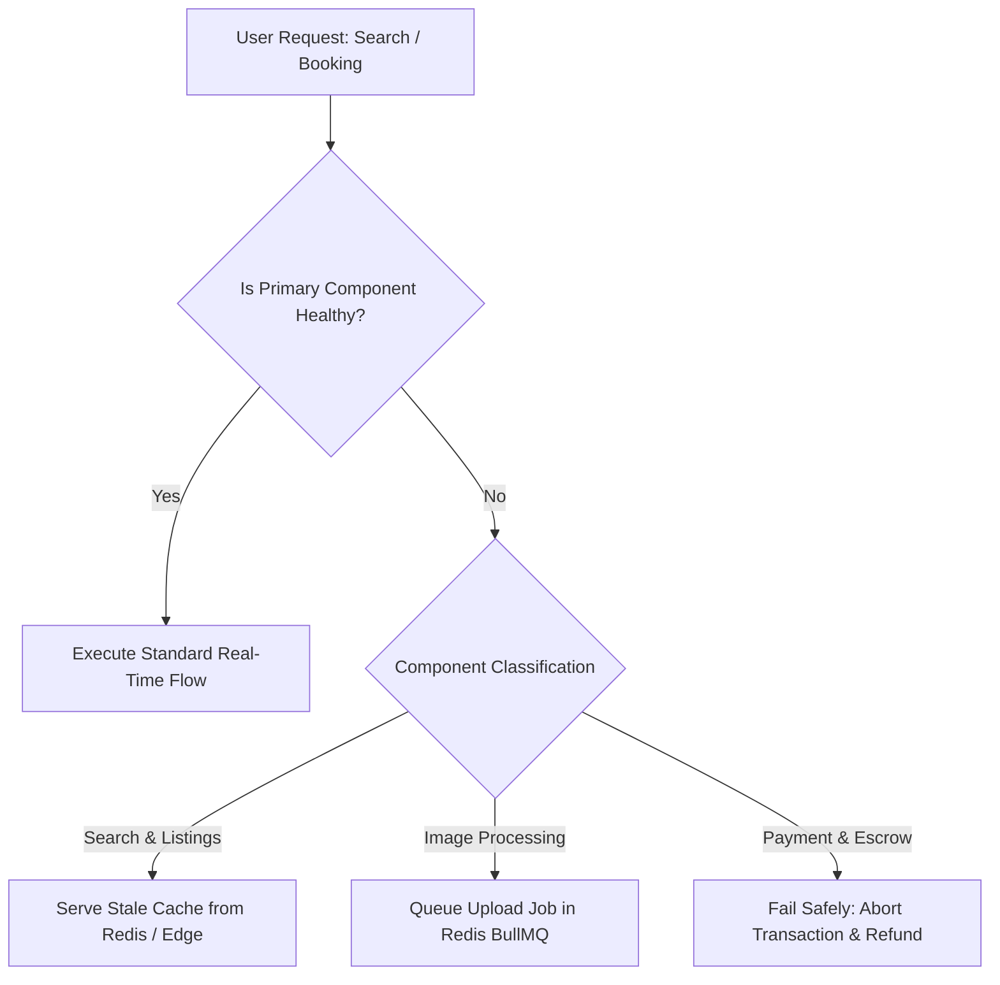

# Business Continuity Plan & Graceful Degradation Framework

## 1. Objectives & Continuity Scope

The Business Continuity Plan (BCP) ensures that critical marketplace operations in Peshawar can sustain partial infrastructure impairments without catastrophic downtime or financial corruption.

---

## 2. Critical User Flows & Priority Matrix

| Priority            | Critical Flow                       | Upstream Dependency              | Degraded Mode Strategy                                                                                                                             |
| :------------------ | :---------------------------------- | :------------------------------- | :------------------------------------------------------------------------------------------------------------------------------------------------- |
| **Tier 1 (Vital)**  | **Property Discovery & Details**    | PostgreSQL, Redis, Elasticsearch | Serve cached search results from Redis or CDN edge cache; disable dynamic AI pricing badges if AI service offline.                                 |
| **Tier 1 (Vital)**  | **Authentication (Login/Register)** | PostgreSQL, Redis, SMS Gateway   | Allow password login; queue OTP SMS verification retry; reject logins if primary user DB offline.                                                  |
| **Tier 1 (Vital)**  | **Booking & Payments**              | PostgreSQL, Payment Gateway      | **Strict Fail-Safe**: If payment gateway or DB transaction fails, cancel intent cleanly; never allow partial bookings without escrow confirmation. |
| **Tier 2 (High)**   | **Inquiries & Direct Messaging**    | PostgreSQL, Socket.io, Redis     | If WebSockets degrade, client falls back to HTTP long-polling (every 5 seconds).                                                                   |
| **Tier 3 (Medium)** | **Media Uploads**                   | S3 / MinIO, Image Processor      | Allow temporary offline draft save; queue background re-upload when storage recovers.                                                              |
| **Tier 3 (Medium)** | **Admin Moderation & Analytics**    | Admin Portal, Read-Replica       | Switch analytics views to read-only stale snapshots; defer heavy batch reporting.                                                                  |

---

## 3. Graceful Degradation Rules (Fail-Safe Architecture)

1. **Transactional Integrity**: Financial transactions and digital rental agreements must never execute in degraded partial mode. If state cannot be transactionally guaranteed in PostgreSQL, the request aborts with an informative message.
2. **Read-Heavy Resiliency**: Read-heavy operations (viewing listings, searching by locality) utilize stale-while-revalidate Redis caches up to 60 minutes old during database maintenance.
3. **Notification Buffering**: If the FCM push or email gateway encounters rate limits or temporary downtime, notifications are queued in BullMQ with exponential backoff up to 24 hours.
