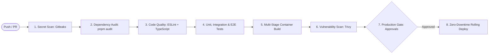

# CI/CD Pipeline Security & Supply Chain Hardening

## 1. Supply Chain Security Baseline

Rental Peshawar CI/CD workflows enforce NIST SP 800-204D and SLSA Level 2 supply chain standards:

1. **Branch Protection on `main`**:
   - Direct pushes and forced pushes (`git push --force`) are blocked.
   - Mandates at least 1 passing peer code review before merge.
   - Requires all automated CI checks (linting, typechecking, tests, security scans) to pass.
2. **Minimal Workflow Permissions**:
   - Workflows explicitly declare minimal permissions:
     ```yaml
     permissions:
       contents: read
       security-events: write
       id-token: write # only for OIDC authentication
     ```
3. **Pinned Action SHAs**:
   - Third-party GitHub Actions must be pinned to full 40-character commit SHAs rather than mutable tags (e.g., `@v4`), preventing upstream supply chain compromises.

---

## 2. CI/CD Security Pipeline Gates



---

## 3. Deployment Gating & Environment Protection

- **Staging Auto-Deploy**: Commits merged to `develop` trigger automated deployment to the Staging environment for verification.
- **Production Gated Approval**:
  - Deployments to `production` require manual approval from designated Engineering Leads via GitHub Environments.
  - Deployment jobs receive scoped, temporary OIDC credentials valid only for the deployment duration.
- **Fork PR Security**: Workflows triggered by external or fork pull requests are isolated and denied access to repository secrets and deployment environments.
- **Ephemeral Runners**: All pipeline jobs execute inside clean, ephemeral virtual machine runners with no cached disk credentials.
