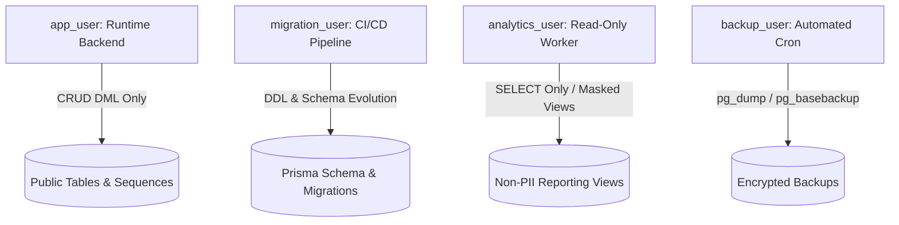

# Database Security, Least Privilege & Data Protection

## 1. Database Architecture & Threat Defense

The Rental Peshawar database tier holds sensitive PII (CNIC numbers, telephone numbers, rental agreements, payment ledgers, and property location coordinates). Direct public access is strictly prevented. Database connections mandate TLS, and database permissions adhere to strict separation of duties.

---

## 2. Least-Privilege Database Role Separation

To mitigate SQL injection or account compromise impact, database privileges are divided into distinct roles:



| Role Name            | Granted Privileges                                                     | Prohibited Privileges                               | Assigned Identity            |
| :------------------- | :--------------------------------------------------------------------- | :-------------------------------------------------- | :--------------------------- |
| **`app_user`**       | `SELECT`, `INSERT`, `UPDATE`, `DELETE` on tables; `USAGE` on sequences | `CREATE`, `DROP`, `ALTER`, `TRUNCATE`, `SUPERUSER`  | API Runtime Backend          |
| **`migration_user`** | Full DDL (`CREATE`, `ALTER`, `DROP`) on schema `public`                | Application runtime query execution                 | CI/CD Deploy Workflow        |
| **`analytics_user`** | `SELECT` on non-PII tables & analytics views                           | Direct access to `users.passwordHash`, `users.cnic` | Read-only BI tool / Metabase |
| **`backup_user`**    | `pg_read_all_data`, replication streaming                              | Direct `UPDATE` or `DELETE`                         | Automated backup job         |

---

## 3. Database Role Initialization (`init-roles.sql`)

```sql
-- 1. Create Least Privilege Application User (CRUD Only)
CREATE ROLE app_user WITH LOGIN PASSWORD 'AppUserStrongPass2026!';
GRANT CONNECT ON DATABASE rental_peshawar_prod TO app_user;
GRANT USAGE ON SCHEMA public TO app_user;
GRANT SELECT, INSERT, UPDATE, DELETE ON ALL TABLES IN SCHEMA public TO app_user;
GRANT USAGE, SELECT ON ALL SEQUENCES IN SCHEMA public TO app_user;
ALTER DEFAULT PRIVILEGES IN SCHEMA public GRANT SELECT, INSERT, UPDATE, DELETE ON TABLES TO app_user;

-- 2. Create Migration User (DDL Permissions)
CREATE ROLE migration_user WITH LOGIN PASSWORD 'MigrationUserStrongPass2026!';
GRANT ALL PRIVILEGES ON DATABASE rental_peshawar_prod TO migration_user;
GRANT ALL PRIVILEGES ON SCHEMA public TO migration_user;

-- 3. Create Read-Only Analytics User (SELECT Only)
CREATE ROLE analytics_user WITH LOGIN PASSWORD 'AnalyticsUserStrongPass2026!';
GRANT CONNECT ON DATABASE rental_peshawar_prod TO analytics_user;
GRANT USAGE ON SCHEMA public TO analytics_user;
GRANT SELECT ON ALL TABLES IN SCHEMA public TO analytics_user;
ALTER DEFAULT PRIVILEGES IN SCHEMA public GRANT SELECT ON TABLES TO analytics_user;

-- Revoke dangerous superuser defaults
REVOKE ALL ON SCHEMA public FROM PUBLIC;
```

---

## 4. Encryption & Connection Hardening

1. **TLS Enforcement**: `DATABASE_URL` must include `sslmode=require` (or `verify-full`). Unencrypted plain TCP connections are refused by `pg_hba.conf`.
2. **Encryption at Rest**: Storage volumes utilize AES-256 (AWS RDS KMS or LUKS block-device encryption).
3. **Database Audit Logging**:
   - `log_connections = on`
   - `log_disconnections = on`
   - `log_duration = on` (for queries > 500ms)
   - `log_statement = 'ddl'` (logs all schema modifications)
   - `pgaudit` extension records all DDL and sensitive role changes.
