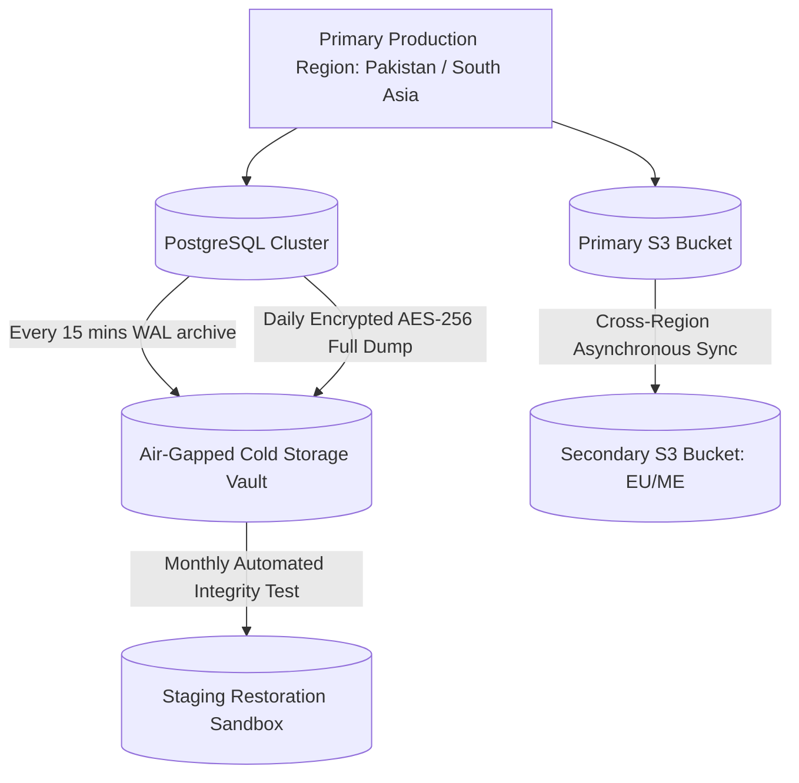

# Disaster Recovery Plan & Business Resiliency Architecture

## 1. Objectives & Metrics

The Rental Peshawar Disaster Recovery (DR) plan establishes the technical procedures and architectural redundancy necessary to recover platform operations following a catastrophic failure (data center loss, ransomware, hardware destruction, or primary cloud region outage).

### Recovery Point Objective (RPO) & Recovery Time Objective (RTO)

| Subsystem                                       | Target RPO (Max Data Loss)     | Target RTO (Max Downtime) | Disaster Strategy                                         |
| :---------------------------------------------- | :----------------------------- | :------------------------ | :-------------------------------------------------------- |
| **Relational Database (PostgreSQL)**            | $\le 15\text{ minutes}$        | $\le 2\text{ hours}$      | Continuous WAL archiving + encrypted daily full snapshots |
| **Object Storage (Property Media & Documents)** | $\le 1\text{ hour}$            | $\le 2\text{ hours}$      | Cross-region S3 bucket replication with Object Lock       |
| **Core API & WebSocket Backend**                | $0\text{ minutes}$ (Stateless) | $\le 2\text{ hours}$      | Containerized deployment via Docker/Kube manifests        |
| **Tenant Web & Admin Dashboards**               | $0\text{ minutes}$ (Stateless) | $\le 4\text{ hours}$      | Static asset CDN caching + container redeployment         |
| **Secrets & Encryption Keys**                   | $0\text{ minutes}$ (Static)    | $\le 1\text{ hour}$       | Multi-region Key Vault / HashiCorp Vault replication      |

---

## 2. Backup Redundancy & Geographic Separation



---

## 3. Disaster Recovery Execution Runbook

### Step 1: Catastrophic Event Declaration

The Incident Commander declares DR mode when the primary data center or cloud region is confirmed offline or unrecoverable within 30 minutes.

### Step 2: Infrastructure Provisioning (Secondary Region)

```bash
# 1. Initialize secondary cluster via Docker Compose / Infrastructure-as-Code
cd infra/
docker compose -f docker-compose.prod.yml up -d postgres redis minio
```

### Step 3: Cryptographic Backup Integrity Verification & Restoration

```bash
# 2. Retrieve latest backup and verify SHA-256 hash before decryption (NIST SP 800-34)
bash scripts/backup/verify-and-restore.sh /var/backups/latest_db.sql.gz.enc rental_peshawar_prod
```

### Step 4: DNS Failover & Traffic Re-Routing

1. In Cloudflare / Route53, update DNS A/AAAA records:
   - `api.rentalpeshawar.pk` -> IP of Secondary Load Balancer
   - `rentalpeshawar.pk` -> IP of Secondary Ingress
   - `admin.rentalpeshawar.pk` -> IP of Secondary Ingress
2. Verify SSL certificate binding and edge WAF rule activation.

### Step 5: Post-Restoration Verification

1. Execute health probes:
   - `curl -f https://api.rentalpeshawar.pk/api/v1/health`
   - `curl -f https://api.rentalpeshawar.pk/api/v1/ready`
2. Perform test inquiry and booking flow in staging sandbox.
3. Open platform to production traffic.
