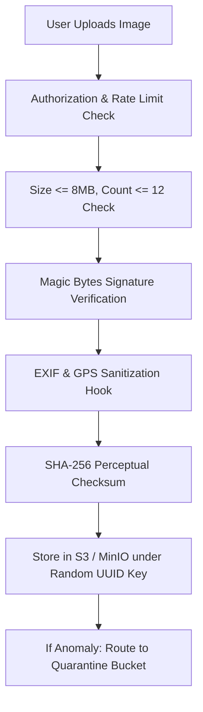

# Peshawar Rental Marketplace — File Upload & Object Storage Security

Phase 16: Security Hardening & Safe Media Handling

This document specifies the validation, processing, storage sandboxing, and quarantine controls applied to all media and document uploads.

---

## 1. Multi-Tier File Validation Pipeline

1. **Pre-Signed Upload Authorization:**
   - Pre-signed upload URLs are generated ONLY for authenticated landlords and verified tenants.
   - Presigned URLs expire after 15 minutes.
2. **Magic Bytes Signature Verification:**
   - File extensions (`.jpg`, `.png`) and `Content-Type` headers are untrusted.
   - The first 16 bytes of every file stream are evaluated:
     - **JPEG:** `FF D8 FF`
     - **PNG:** `89 50 4E 47 0D 0A 1A 0A`
     - **WebP:** `52 49 46 46 ... 57 45 42 50`
   - Files failing magic byte checks are immediately rejected.
3. **EXIF & Geotag Stripping:**
   - Property and selfie uploads are stripped of GPS coordinates and camera serial numbers before being rendered publicly to protect landlord and tenant domestic privacy.
4. **Storage Isolation & Non-Guessable Keys:**
   - Storage keys follow: `media/{entityType}/{randomUuid}.webp`.
   - Direct directory listing is disabled on MinIO and AWS S3 buckets.
   - Public write access is strictly forbidden (`BlockPublicAcls: true`, `BlockPublicPolicy: true`).
