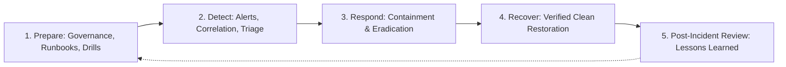

# Incident Response Plan (NIST SP 800-61 Rev. 3 Aligned)

## 1. Incident Response Lifecycle

The Rental Peshawar Incident Response Plan aligns with NIST SP 800-61 Revision 3, organizing the operational response around continuous preparation, detection, containment, eradication, recovery, and post-incident improvement.

---

## 2. Incident Severity Classification

| Severity           | Definition                                                                                                  | Target Acknowledgement | Target Containment    | Target Resolution     | Examples                                                                                  |
| :----------------- | :---------------------------------------------------------------------------------------------------------- | :--------------------- | :-------------------- | :-------------------- | :---------------------------------------------------------------------------------------- |
| **SEV1: Critical** | System-wide outage, confirmed customer PII/CNIC breach, mass account takeover, payment escrow compromise.   | $\le 10\text{ mins}$   | $\le 1\text{ hour}$   | $\le 4\text{ hours}$  | Mass database exfiltration, unauthorized role change to `SUPER_ADMIN`, active ransomware. |
| **SEV2: Major**    | Significant feature outage, security control circumvention, active brute-force or credential-stuffing wave. | $\le 30\text{ mins}$   | $\le 2\text{ hours}$  | $\le 8\text{ hours}$  | Refresh token replay vulnerability, landlord payout bypass, localized DoS.                |
| **SEV3: Moderate** | Isolated abuse, non-critical vulnerability, single account compromise with contained scope.                 | $\le 2\text{ hours}$   | $\le 6\text{ hours}$  | $\le 24\text{ hours}$ | Isolated fake listing fraud, single user credential stuffing, non-exploited High CVE.     |
| **SEV4: Minor**    | Informational alert, cosmetic security defect, low-risk misconfiguration.                                   | $\le 8\text{ hours}$   | $\le 24\text{ hours}$ | $\le 72\text{ hours}$ | Header misconfiguration, minor rate limit anomaly.                                        |

---

## 3. Incident Response Team & Responsibilities

| Role                        | Responsibilities                                                                                           | Assigned Individual             |
| :-------------------------- | :--------------------------------------------------------------------------------------------------------- | :------------------------------ |
| **Incident Commander (IC)** | Holds singular operational authority over the incident, coordinates workstreams, establishes comms bridge. | Senior Engineering Lead On-Call |
| **Security Lead**           | Conducts forensic analysis, coordinates threat hunting, designs eradication steps.                         | CISO / AppSec Lead              |
| **Backend On-Call**         | Inspects NestJS API logs, implements hotfixes, invalidates compromised sessions.                           | Primary API On-Call             |
| **Infrastructure On-Call**  | Manages cloud networking, WAF rate limits, container restarts, database failovers.                         | Platform / DevOps Engineer      |
| **Product Owner**           | Assesses customer impact, approves feature degradation or temporary maintenance windows.                   | Rental Product Manager          |
| **Support Lead**            | Gathers user reports, equips tenant/landlord support agents with approved talking points.                  | Customer Operations Manager     |
| **Legal & Privacy Advisor** | Coordinates regulatory disclosure requirements (PECA / PTA) and data protection guidance.                  | Corporate Legal Counsel         |
| **Communications Lead**     | Manages external status page updates, customer notifications, and press releases.                          | Head of Public Relations        |

---

## 4. Operational Playbook Stages

### Stage 1: Detection & Triage

1. Alert fires via Prometheus / Security Detection Engine / User Report.
2. Incident Commander verifies authenticity, confirms scope, and assigns initial SEV level.
3. Incident Commander launches dedicated incident response channel `#incident-<id>` and opens secure video bridge.

### Stage 2: Containment (Stop the Bleeding)

- **Short-Term Containment**:
  - Compromised user: Revoke active sessions and force password reset.
  - Abusive IP: Apply WAF rate limit or IP drop at ingress proxy.
  - Exposed credential: Rotate key immediately in Secrets Manager and trigger rolling restart.
- **Evidence Preservation**:
  - Snapshot affected container logs, database transaction logs, and WAF telemetry.
  - Store evidence in append-only cold storage with SHA-256 integrity hashes.

### Stage 3: Eradication & Remediation

- Identify and eliminate root cause (e.g., patch authorization check, deploy hotfix).
- Validate no persistent adversary access (backdoors, unauthorized API keys, orphan admin accounts).

### Stage 4: Verified Recovery

- Restore affected services to clean operational state.
- Verify backup integrity prior to any database restoration.
- Continuously monitor detection dashboards for recurrence over 48 hours.

### Stage 5: Post-Incident Review (PIR)

Within 72 hours of SEV1/SEV2 resolution, the Incident Commander publishes a formal Post-Incident Review containing:

- **Incident ID & Timeline**: Chronological log of detection, response milestones, and resolution.
- **Root Cause Analysis (5 Whys)**: Underlying technical or process failure.
- **Preventive Action Items**: Jira backlog tickets with designated owners and target completion dates.
