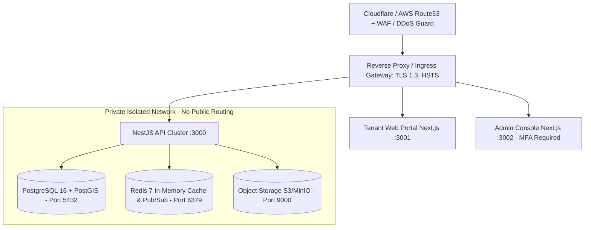

# Infrastructure Security Architecture & Baseline

## 1. Overview & Security Posture

The Rental Peshawar platform enforces a defense-in-depth infrastructure model. Every component—from edge DNS to database storage engines—is hardened according to CIS Benchmarks, NIST SP 800-53, and OWASP ASVS Level 3 requirements.

Public traffic terminates exclusively at authenticated edge ingress points (Cloudflare / Edge Reverse Proxy with TLS 1.3). The application services run inside private network zones without public IP exposure for stateful dependencies (PostgreSQL, Redis, MinIO/S3).

---

## 2. Infrastructure Topology



---

## 3. Defense-in-Depth Control Baseline

| Layer                    | Security Controls                                                                       | Enforcement Mechanism                                        |
| :----------------------- | :-------------------------------------------------------------------------------------- | :----------------------------------------------------------- |
| **Edge / DNS**           | DDoS mitigation, Bot detection, TLS 1.3 termination, Managed WAF                        | Cloudflare Enterprise / AWS CloudFront + Shield              |
| **Ingress Proxy**        | Mutual TLS/HSTS, rate limiting (100 req/min/IP), strict CORS                            | Nginx Hardened Reverse Proxy (`infra/nginx/nginx.prod.conf`) |
| **Compute / Containers** | Non-root runtime (`UID 1001`), read-only root filesystems, dropped capabilities (`ALL`) | Docker Compose Hardening & Kubernetes Pod Security Standards |
| **Application Layer**    | Deny-by-default RBAC, DTO validation, SSRF guard, XSS sanitization                      | NestJS `PolicyEngineService`, class-validator                |
| **Secrets Management**   | Zero plaintext secrets in code/images, short-lived tokens, dynamic rotation             | AWS Secrets Manager / HashiCorp Vault / Doppler              |
| **Database**             | Private subnet isolation, TLS connections, least-privilege SQL users, encrypted at rest | PostgreSQL 16 + pgCrypto / AWS RDS KMS                       |
| **Cache & Queue**        | Password authentication, TLS, no public port exposure                                   | Redis 7 `--requirepass`                                      |
| **Storage**              | Deny public listing, deny public write, pre-signed upload URLs (15-min TTL), SSE-S3/KMS | MinIO / AWS S3 Bucket Policies                               |

---

## 4. Environment Segregation Matrix

Strict separation prevents configuration, credentials, and data from cross-contaminating environments:

```
Production:  https://rentalpeshawar.pk, https://api.rentalpeshawar.pk (VPC: 10.100.0.0/16)
Staging:     https://staging.rentalpeshawar.pk (VPC: 10.101.0.0/16)
Development: http://localhost:3000 (Local Docker network: 172.28.0.0/16)
```

1. **Database Segregation**: Staging and Development never connect to Production databases.
2. **Data Sanitization**: Production database dumps are strictly masked and pseudonymized before being restored in staging or dev.
3. **Credential Segregation**: Any non-production service attempting to authenticate using a production secret key will immediately fail through automated startup guards (`EnvironmentGuard`).
