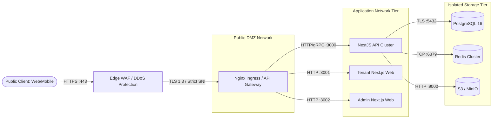

# Network Security, Perimeter Defense & Traffic Isolation

## 1. Perimeter Architecture

The Rental Peshawar network model operates under strict traffic isolation. Direct access to database and cache ports (`5432`, `6379`) from public IP spaces is categorically blocked at the hypervisor and firewall layer.

---

## 2. Ingress & TLS Configuration Standards

- **TLS Protocols**: TLS 1.2 and TLS 1.3 only. All legacy protocols (SSLv3, TLS 1.0, TLS 1.1) are rejected.
- **Cipher Suites**: Modern PFS ciphers (`ECDHE-ECDSA-AES128-GCM-SHA256`, `ECDHE-RSA-AES128-GCM-SHA256`, `ECDHE-ECDSA-AES256-GCM-SHA384`, `ECDHE-RSA-AES256-GCM-SHA384`).
- **HSTS**: `Strict-Transport-Security: max-age=63072000; includeSubDomains; preload`
- **HTTP Redirection**: All incoming port 80 traffic is redirected via `301 Moved Permanently` to `https://...`.

---

## 3. Firewall & Security Group Rules

| Tier              | Source             | Destination   | Port/Protocol | Action    | Description                       |
| :---------------- | :----------------- | :------------ | :------------ | :-------- | :-------------------------------- |
| **Edge Ingress**  | Any (`0.0.0.0/0`)  | Reverse Proxy | `TCP/443`     | **ALLOW** | Public HTTPS Web & API traffic    |
| **Edge Ingress**  | Any (`0.0.0.0/0`)  | Reverse Proxy | `TCP/80`      | **ALLOW** | HTTP to HTTPS redirection         |
| **API Backend**   | Reverse Proxy      | Backend API   | `TCP/3000`    | **ALLOW** | Ingress traffic to API containers |
| **Web Frontend**  | Reverse Proxy      | Web Next.js   | `TCP/3001`    | **ALLOW** | SSR tenant web rendering          |
| **Admin Console** | VPN / Allowlist IP | Admin Next.js | `TCP/3002`    | **ALLOW** | Staff portal restricted access    |
| **Database**      | Backend API Subnet | PostgreSQL    | `TCP/5432`    | **ALLOW** | Relational queries from API only  |
| **Database**      | Any other source   | PostgreSQL    | `TCP/5432`    | **DENY**  | Public database access blocked    |
| **Redis Cache**   | Backend API Subnet | Redis         | `TCP/6379`    | **ALLOW** | Cache & session access from API   |
| **Redis Cache**   | Any other source   | Redis         | `TCP/6379`    | **DENY**  | Public Redis access blocked       |
| **Storage API**   | Backend API Subnet | S3/MinIO      | `TCP/9000`    | **ALLOW** | Signed URL generation & media ops |

---

## 4. DDoS Mitigation & Rate Limiting

1. **Edge Burst Buffers**: Cloudflare / AWS Shield filters SYN floods, UDP amplification, and Layer 7 volumetric attacks.
2. **Reverse Proxy Throttling**:
   - Authentication endpoints: 10 requests / min / IP.
   - Search & listings: 60 requests / min / IP.
   - General API: 120 requests / min / IP.
3. **Bot Mitigation**: Cloudflare Turnstile / Managed Challenges intercept automated scraping attempts.
