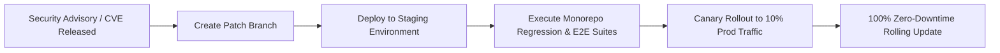

# Patch Management & Security Maintenance Policy

## 1. Scope & Objective

This policy defines the procedures for testing, staging, approving, and rolling out security patches across operating systems, container base images, runtime engines (Node.js, Dart/Flutter), databases, and third-party dependencies.

---

## 2. Patch Categorization & Deployment Schedules

| Category                           | Description                                                  | Staging Window              | Production Rollout               | Approval Required                |
| :--------------------------------- | :----------------------------------------------------------- | :-------------------------- | :------------------------------- | :------------------------------- |
| **Emergency Security Patch**       | Actively exploited Zero-Day or CVSS $\ge 9.0$ vulnerability. | 2 hours testing in Staging  | Immediate rolling deployment     | Security Lead & Engineering Lead |
| **Scheduled Security Update**      | High/Medium CVE updates without active exploit.              | 48 hours testing in Staging | Bi-weekly Tuesday maintenance    | Engineering Lead                 |
| **Standard Feature / Minor Patch** | Routine dependency bug fixes, non-security updates.          | 1 full sprint in Staging    | Regular bi-weekly sprint release | Product Owner & Tech Lead        |

---

## 3. Patching Pipeline & Validation Steps

1. **Pre-Deployment Regression Testing**: Patches must pass `pnpm test`, `pnpm test:e2e`, and Flutter integration tests before deployment.
2. **Zero-Downtime Rolling Update**: Container orchestration performs rolling container replacements with readiness probes to eliminate service downtime.
3. **Automated Rollback**: If health checks fail or error rates spike $> 1\%$ in the 15 minutes post-deployment, the orchestrator triggers an immediate rollback to the preceding image SHA.
