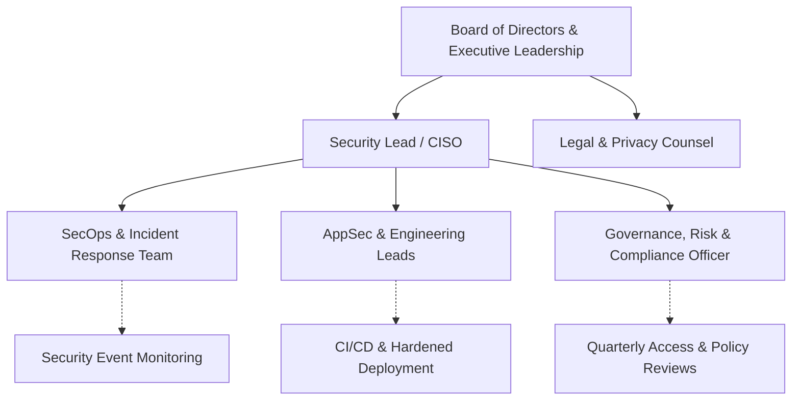

# Security Governance & Organizational Risk Framework

## 1. Overview & Governance Charter

The Rental Peshawar Security Governance Framework establishes the executive oversight, operational responsibilities, risk management standards, and compliance mechanisms required to protect tenant, landlord, and administrative assets in accordance with NIST Cybersecurity Framework (CSF) 2.0, ISO/IEC 27001:2022, and relevant Pakistani privacy regulations (PECA 2016).

---

## 2. Security Organization & Roles

### Roles and Responsibilities Matrix

| Role                              | Primary Responsibilities                                                                                  | Reporting Line         |
| :-------------------------------- | :-------------------------------------------------------------------------------------------------------- | :--------------------- |
| **Chief Executive Officer (CEO)** | Overall executive accountability for corporate risk posture and resource allocation.                      | Board of Directors     |
| **Security Lead / CISO**          | Directs cybersecurity strategy, oversees incident response, security operations, and zero-trust controls. | CEO / Board            |
| **Engineering / DevOps Lead**     | Enforces secure SDLC, infrastructure hardening, container security, and CI/CD pipelines.                  | Security Lead          |
| **Data Protection Officer (DPO)** | Governs PII compliance, user data rights (access, deletion, export), and privacy impact assessments.      | General Counsel / CISO |
| **Incident Commander**            | Leads operational handling of high-severity security incidents (SEV1/SEV2) through to resolution.         | CISO                   |

---

## 3. Risk Management & Exception Management

1. **Risk Register**: Every identified vulnerability, third-party dependency exposure, or architectural gap is cataloged in the centralized Risk Register with owner, likelihood, impact, and remediation target.
2. **Security Exception Lifecycle**:
   - Any deviation from baseline security standards requires a formal **Security Exception Request**.
   - Requires dual approval from Engineering Lead and Security Lead.
   - Valid for a maximum of 90 days, after which it must be remediated or formally re-assessed.

---

## 4. Policy Hierarchy & Review Frequency

| Document Level                      | Scope                                                | Review Cadence            | Approval Authority |
| :---------------------------------- | :--------------------------------------------------- | :------------------------ | :----------------- |
| **Level 1: Corporate Policies**     | Acceptable Use, Information Security, Privacy        | Annual                    | Executive Board    |
| **Level 2: Operating Standards**    | Access Review, Patching, Secrets, Data Retention     | Semi-Annual               | Security Lead      |
| **Level 3: Operational Procedures** | Incident Response, Backup Verification, Sudo Step-Up | Quarterly / Post-Incident | Engineering Leads  |
