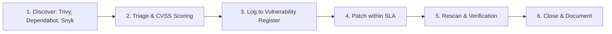

# Vulnerability Management & Assessment Policy

## 1. Vulnerability Management Lifecycle

Rental Peshawar enforces a rigorous vulnerability detection, tracking, prioritization, and patching lifecycle based on CVSS v3.1 scoring.

---

## 2. Vulnerability Remediation Service Level Agreements (SLAs)

| Severity Level | CVSS Score Range | Remediation SLA           | Escalation Path                                            |
| :------------- | :--------------- | :------------------------ | :--------------------------------------------------------- |
| **Critical**   | $9.0 - 10.0$     | **$\le 24\text{ hours}$** | Immediate emergency hotfix, IC assigned, CEO/CTO notified. |
| **High**       | $7.0 - 8.9$      | **$\le 7\text{ days}$**   | Scheduled sprint interrupt, Security Lead review.          |
| **Medium**     | $4.0 - 6.9$      | **$\le 30\text{ days}$**  | Prioritized in upcoming sprint cycle.                      |
| **Low**        | $0.1 - 3.9$      | **$\le 90\text{ days}$**  | General quarterly maintenance cycle.                       |

---

## 3. Vulnerability Scanning Cadence

1. **Automated Dependency Scans**: Run weekly and on every pull request via `pnpm audit` and Dependabot.
2. **Container Image Scans**: Executed on every release build via Trivy (`aquasecurity/trivy-action`). Builds containing unpatched Critical CVEs are blocked automatically.
3. **Static Application Security Testing (SAST)**: Executed in CI pipeline via ESLint security plugins and Semgrep.
4. **Third-Party Penetration Testing**: Contracted annually with CREST-accredited offensive security partners to assess external endpoints, mobile APIs, and admin authorization boundaries.

---

## 4. Centralized Vulnerability Register Structure

Every vulnerability identified from scans or bug bounty disclosures is tracked using the following schema:

| Finding ID      | Severity | CVE / CWE     | Affected Component      | Responsible Owner | Detection Date | SLA Deadline | Status   | Verification Evidence       |
| :-------------- | :------- | :------------ | :---------------------- | :---------------- | :------------- | :----------- | :------- | :-------------------------- |
| `VULN-2026-001` | High     | CVE-2026-XXXX | `apps/api/package.json` | Platform Lead     | 2026-11-01     | 2026-11-08   | Resolved | `pnpm audit` clean report   |
| `VULN-2026-002` | Medium   | CWE-79        | `apps/web/PropertyCard` | Frontend Lead     | 2026-11-05     | 2026-12-05   | Resolved | DOMPurify test verification |
