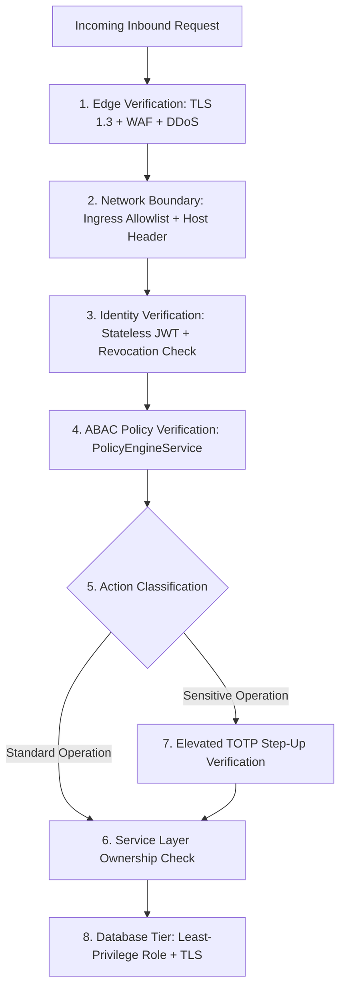

# Zero-Trust Architecture & Threat Verification Model

## 1. Core Zero-Trust Tenets (NIST SP 800-207)

Rental Peshawar is built around five fundamental zero-trust principles:

1. **Never Trust, Always Verify**: Network location does not confer trust. Whether a request originates inside a local Kubernetes pod or from the public internet, it must authenticate and present valid cryptographic claims.
2. **Least Privilege by Default**: Every microservice, background worker, database account, and human operator possesses only the minimal entitlements necessary for their function.
3. **Assume Breach**: Systems assume an adversary is already present on the network. East-West traffic is authenticated, encrypted, and isolated across boundaries.
4. **Explicit Verification of State**: Machine state, user identity, MFA verification age, and request velocity are continuously evaluated before granting access.
5. **Data-Centric Protection**: Sensitive PII (CNICs, phone numbers, location data) is encrypted at rest, in transit, and masked during log output.

---

## 2. Zero-Trust Verification Framework

---

## 3. Mutual Microservice & Subsystem Trust Boundaries

1. **API to Database**: Restricted to `app_user` with TLS (`sslmode=require`).
2. **API to Redis**: Password authenticated (`requirepass`) over internal network; keys isolated with prefixes (`session:`, `velocity:`, `cache:`).
3. **API to Object Storage**: Direct S3 credentials held only by the API service; client web and mobile applications interact exclusively via short-lived pre-signed URLs (15 minutes max TTL).
4. **Administrative Console to API**: Requires administrative JWT, active TOTP session, and step-up grant for high-value actions.
5. **Background Jobs / BullMQ**: Worker processes assume decoupled task roles; job payloads contain resource IDs rather than raw sensitive PII.
